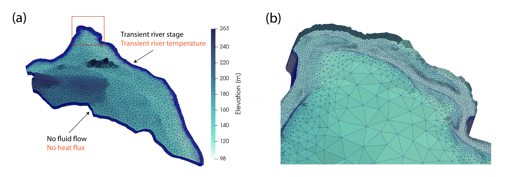

# README

## About
This repo contains workflows to setup the Hanford unstructured, reach scale, PFLOTRAN model with modified perm for the alluvium layer. This model simulates subsurface flow and thermal processes.



## folder structure
```
HFR-riverbed/
├── data/                  # model input datasets
│   ├── HFR_H_Initial.h5               # initial head condition
│   ├── perm_data_*.h5                 # permeability fields (alluvium, riverbed, basalt variants)
│   └── riverbed_permeability_input.vtu
├── figures/               # figures used in this README and manuscript
│   └── mesh.jpg
├── model_run/
│   └── inputs/            # PFLOTRAN input decks and run scripts
│       ├── HFR-model-100m-*.in        # flow / TH model decks
│       ├── TH_*_alluvium*.in          # TH runs with homogeneous vs. heterogeneous alluvium perm
│       ├── *_obs_block.in, *_region_block.in   # well/piezometer observation and region blocks
│       ├── data_from_USGS*.csv        # USGS data used for alluvium K
│       └── run*.sh, debug.sh          # job submission scripts
├── notebooks/             # pre- and post-processing workflows (see notebooks/README.txt)
│   ├── mesh_hanford.ipynb, generate_*.ipynb, PFLOTRAN_input_deck.ipynb   # build mesh, materials, BCs, input deck
│   ├── plot_*.ipynb                   # compare simulations with observations, plot fluxes/temperature/tracer
│   ├── *.py                           # helper modules (myfunc.py, fav_colors.py, ncdump.py, ...)
│   └── src/                           # Python/R script versions of the notebooks
└── spinup/
    └── HFR-model-100m-flow-updated_mesh-restart.h5   # flow spin-up restart file
```

## notes
- data_from_USGS_1.csv is an updated version and is used in alluvium K
- perm_data_only_alluvium_smoothed_cutoff.h5 is the perm file that has smoothed the K and cutoff the extreme small and large values. 


## to run PFLOTRAN on NERSC
Load/set the following modules/environment variables for the respective PrgEnv.

- **Intel** (not working!)
```
source /global/common/software/pflotran/.pflotran_perl_intel
```

- **GNU** (working)
```
source /global/common/software/pflotran/.bashrc_perl_gnu
```
